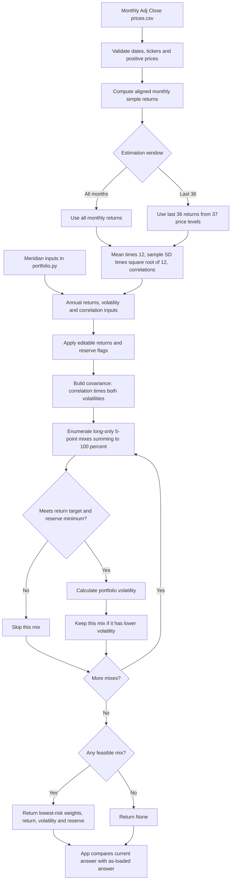

# Lab 15 — Portfolio Stability Decision

**Prepared:** October 22, 2026.  
**Training case:** Meridian Foundation Reserve.  
**Project 2 case:** Oak Grove Scholarship Reserve, the fictional proposed client from Lab 13, carried forward in Lab 14.  
**Preparation:** Built with AI help, a learning demonstration, not investment advice. Personal participation is recorded separately below.

## D — Which mix carries the least risk while meeting the mandate, and does it survive a one-point change?

On Meridian's inputs, the lowest-volatility 5-point mix is **0% bills / 20% 10-year Treasury / 25% IG bonds / 55% equity**, with **6.51% expected return** and **9.44% volatility**. Lowering only the equity return estimate from 8% to 7% changes it to **0% / 10% / 10% / 80%**, with **6.53% expected return** and **12.94% volatility**. The largest weight change is **25 percentage points**: the allocation is sensitive to one estimate.

For Oak Grove, the all-months estimate selects **75% BIL / 25% VT**. Using the last 36 months selects **90% BIL / 10% VT**, a **15-point** largest weight change. A separate one-point cut to VT's all-months return estimate increases its weight from 25% to 30%, a **5-point** move. My proposed call is to **pilot** the all-months allocation as a research starting point, subject to the conditions below.

My partner questioned the roughly 20% equity return estimate and selected **15%** instead. Applying that change to VT in the 36-month model selects **85% BIL / 15% VT**, a **5-point** shift from the unstressed 36-month allocation, with **5.96% expected return** and **1.79% volatility**.

## Continuity — What Lab 14 required

Lab 14 explicitly requested a **new standalone `portfolio.py`**, while retaining the earlier `mandate.py` checker and adding benchmark candidate E to it. The required [Lab 14 portfolio.py](../Lab%2014/portfolio.py) already existed separately from [Lab 13 mandate.py](../Lab%2013/mandate.py), so no missing file needed to be reconstructed. Both Lab 14's original baseline run and its verification script passed before this extension.

[This lab's portfolio.py](portfolio.py) copies that engine and adds `search_lowest_risk` and `estimate_from_csv`. Its command-line output is byte-for-byte identical to Lab 14's, retained in [sources/Lab14-baselines.txt](sources/Lab14-baselines.txt). The app imports and calls this engine; it contains no separate covariance, estimation or optimization calculation.

This assignment requires three to six **funds**, not an individual company. The selected universe remains BIL, IEF, LQD and VT. ELV remains the requested company for any company-specific work, but is not substituted into this fund-only lab.

## R — Mandate, funds and price sources

Oak Grove is the proposed $10 million scholarship reserve with a seven-year horizon and $50,000 quarterly distributions. Its return objective is CPI + 3% annually, net of costs, over rolling five-year periods. For this lab, keep the prior **2.5% CPI estimate**, giving an additive **5.5% nominal target**. The reserve floor is `4 × $50,000 / $10,000,000 = 2%`. The target was not lowered to obtain a feasible mix.

The lab's search minimizes estimated annual volatility subject to this return target, the reserve floor, long-only weights and full investment. This is a provisional modeling choice consistent with the current assignment, not a claim that a real client answered the optimization question posed in Lab 13. Costs, taxes, rolling-real-return attainment, turnover, ongoing distributions and rebalancing are not modeled; this gross historical-return screen cannot establish the net-of-cost mandate's achievement.

| Ticker | Fund | Role | Reserve treatment in this exercise |
|---|---|---|---|
| BIL | State Street SPDR Bloomberg 1–3 Month T-Bill ETF | Cash / short Treasury reserve proxy | Eligible |
| IEF | iShares 7–10 Year Treasury Bond ETF | Government bonds | Eligible Treasury proxy |
| LQD | iShares iBoxx $ Investment Grade Corporate Bond ETF | Corporate fixed income | Ineligible |
| VT | Vanguard Total World Stock ETF | Global equity | Ineligible |

BIL and IEF eligibility is an explicit exercise assumption for Treasury fund proxies, requiring confirmation before implementation. IEF has duration risk and is not a single Treasury note. Both selected allocations hold only BIL as the reserve asset, so removing IEF's reserve eligibility would not invalidate these results. The app exposes each flag for review.

[prices.csv](prices.csv) is copied unchanged from Lab 14: **61 monthly adjusted price levels from September 2021 through September 2026**, providing **60 monthly returns from October 2021 through September 2026**. Each date labels the monthly bar by its first calendar day; it is not the date on which the month's closing price became knowable. The last-36-month run uses returns from **October 2023 through September 2026**, calculated using 37 price levels beginning September 2023. The incomplete October 2026 month is excluded.

| Ticker | Source | Original download date |
|---|---|---|
| BIL | [Yahoo Finance monthly history](https://finance.yahoo.com/quote/BIL/history/?frequency=1mo) | October 20, 2026 |
| IEF | [Yahoo Finance monthly history](https://finance.yahoo.com/quote/IEF/history/?frequency=1mo) | October 20, 2026 |
| LQD | [Yahoo Finance monthly history](https://finance.yahoo.com/quote/LQD/history/?frequency=1mo) | October 20, 2026 |
| VT | [Yahoo Finance monthly history](https://finance.yahoo.com/quote/VT/history/?frequency=1mo) | October 20, 2026 |

Lab 14 retrieved Yahoo's chart endpoint with `interval=1mo` and the `indicators.adjclose[0].adjclose` field. Exact URLs, UTC download timestamps and SHA-256 hashes are retained in [sources/Prices.json](sources/Prices.json); [sources/yahoo](sources/yahoo/) contains the original responses. Lab 15 reuses that frozen download, not a new download dated today. The verification checks the CSV against the source record and verifies the retained response hashes. There is no interpolation, missing-month filling or dividend double counting.

## I — Engine and app

Run from `Lab 15`:

```sh
python3 portfolio.py
.venv/bin/python -m streamlit run app.py
.venv/bin/python support/check_results.py
```

Installation and GitHub instructions are in [README.md](README.md). The engine is standard-library Python; the page uses Streamlit 1.50.0.

Monthly simple returns are `P[t] / P[t−1] − 1`. Annual expected-return **estimates** equal the arithmetic monthly mean times 12; annual volatility estimates equal sample monthly standard deviation (`n−1` denominator) times √12. Correlations use the same aligned return months. These are historical estimates, not forecasts or geometric compound growth rates.

The search enumerates all **1,771** four-asset allocations in 5-percentage-point steps that sum to 100%. It rejects mixes below the return target or reserve floor, evaluates volatility using the original covariance functions, and retains the lowest-volatility feasible result. If none is feasible, it returns `None`, and the app displays **“no mix meets the objective.”** It does not relax the mandate. The 5-point grid means a 2% or 3% reserve floor requires at least 5% on the grid; the winning mixes here have much larger reserve weights. “Lowest risk” means lowest estimated volatility on this grid, not an unrestricted continuous optimum or a guarantee against losses.

The as-loaded panel uses the original returns and, for a CSV, all months. Both panels use the same current objective and reserve rule, so a return or estimation-window change is compared under a fixed mandate. The current window switch re-estimates means, volatilities and correlations; it is not a pure return-only stress. Changing the data/window resets the editable return boxes to the corresponding estimates.

### Mermaid flowchart

This is the requested AI-generated diagram of the code; it does not replace the independent paper drawing.



## V — Required training checks

| Meridian run | Bills / 10-year / IG / equity | Return | Volatility | Reserve |
|---|---|---:|---:|---:|
| As loaded | 0 / 20 / 25 / 55 | 6.51% | 9.44% | 20.00% |
| Equity estimate 8% → 7% | 0 / 10 / 10 / 80 | 6.53% | 12.94% | 10.00% |
| IG–equity correlation 0.25 → 0.50 in both cells, original returns | 0 / 40 / 0 / 60 | 6.52% | 9.73% | 40.00% |

Largest absolute weight change for the one-point return stress: `max(0, 10, 15, 25) = 25 points`. Volatility rises by **3.50 points**. A lower assumed equity return requires more equity to reach the unchanged 6.5% target; an optimizer can therefore increase risk when a forecast becomes less favorable.

The app tests edit the return widget and check the displayed answers. A disposable copy of `portfolio.py` is changed to correlation 0.50 in both cells, the same app session is rerun, and the expected 0 / 40 / 0 / 60 answer appears. The delivered engine retains 0.25. This verifies the app responds to its imported engine rather than displaying typed-in answers.

All **nine automated checks passed**, including original stdout preservation, source integrity, NumPy cross-checks of the estimates, an independent exhaustive search, malformed input rejection, infeasible targets and app behavior. See [outputs/Verification.txt](outputs/Verification.txt) and full precision [outputs/Results.json](outputs/Results.json). Automated upload testing injects the CSV byte stream at the file-upload widget boundary because the installed Streamlit version's AppTest lacks a file-upload control API.

The live page was also inspected in Safari on October 22, 2026: the Meridian equity box was changed to 7%, showing 6.53% return, 12.94% volatility and a 25-point largest change; `prices.csv` was uploaded through the actual file picker, showing 75% BIL / 25% VT; switching to 36 months showed 90% BIL / 10% VT and a 15-point change. The page and result tables were visually reviewed. This was agent-operated browser verification, not a human partner exercise.

## Your universe — Estimates and results

All values below are annual **estimates**; the return target stays 5.5%, and the reserve floor stays 2%.

| Asset | All-month return estimate | All-month volatility | Last-36 return estimate | Last-36 volatility |
|---|---:|---:|---:|---:|
| BIL | 3.59% | 0.51% | 4.37% | 0.21% |
| IEF | −1.79% | 7.65% | 3.07% | 6.66% |
| LQD | −0.81% | 9.79% | 4.84% | 7.82% |
| VT | 11.90% | 14.92% | 20.25% | 11.71% |

| Run | BIL | IEF | LQD | VT | Return estimate | Volatility estimate | Reserve |
|---|---:|---:|---:|---:|---:|---:|---:|
| All 60 monthly returns | 75.00% | 0.00% | 0.00% | 25.00% | 5.67% | 3.83% | 75.00% |
| Last 36 monthly returns | 90.00% | 0.00% | 0.00% | 10.00% | 5.95% | 1.21% | 90.00% |
| Partner attack: last 36 months; VT return estimate set to 15% | 85.00% | 0.00% | 0.00% | 15.00% | 5.96% | 1.79% | 85.00% |
| All months; only VT return estimate reduced by 1 point | 70.00% | 0.00% | 0.00% | 30.00% | 5.78% | 4.56% | 70.00% |

The largest window-driven weight change is **15 percentage points**, shared by BIL (+15) and VT (−15). For the fictional $10 million reserve, that shifts **$1.5 million** from VT into BIL. The last-36-month sample assigns much higher expected returns to VT and BIL, so the optimizer can reach the target with less equity. This does not show that future risk fell to 1.21%; the two risk numbers are based on different estimation windows.

The one-point VT stress uses its full-precision all-month estimate, **11.895238…% → 10.895238…%**, with volatility and correlation unchanged. The largest weight change is **5 points**, or **$500,000** on the same fictional portfolio. Its displayed expected return rises from 5.67% to 5.78% because the coarse grid requires a jump to 30% VT; it does not mean the lower equity forecast improved investment prospects.

## Partner attack — equity return estimate reduced to 15%

**Partner's concern and replacement value, reported by the student:** My partner distrusts the approximately **20% equity return estimate** and changed it to **15%**. This corresponds to reducing VT's **20.25% annual return estimate from the last 36 monthly returns** by approximately **5.25 percentage points**. This partner attack is distinct from the lab's required one-point Meridian check, which remains documented above.

**Reproduced result:** Holding the 36-month volatilities, correlations, other assets' return estimates, 5.5% objective and 2% reserve minimum fixed, the engine selects **85% BIL / 0% IEF / 0% LQD / 15% VT**. Expected return is **5.96%**, volatility is **1.79%**, and eligible reserve weight is **85.00%**. The largest weight change from the unstressed 36-month mix of 90% BIL / 10% VT is **5 percentage points**, shifting **$500,000** from BIL into VT on the fictional $10 million portfolio. These results were reproduced with the engine and the app's automated widget check using the partner's reported input; they are not an invented record of the partner's screen or spoken explanation.

**Two-sentence response draft:** When my partner reduced VT's roughly 20% return estimate to 15%, the 36-month model increased equity from 10% to 15%, producing an 85% BIL / 15% VT mix with 5.96% expected return, 1.79% volatility and a 5-percentage-point largest weight change. I would keep the allocation at the pilot stage because the lower equity estimate requires more equity and raises volatility from 1.21% to 1.79% to meet the unchanged 5.5% objective, while the separate 15-point window sensitivity remains unresolved.

**Reading the comparison correctly:** The app displays **10.00 points** against its as-loaded all-months reference of 75% BIL / 25% VT. The effect of this partner attack alone is **5 points** relative to the unstressed 36-month mix, not 10 or 15 points. Expected portfolio return rounds slightly higher after the stress because the 5-point allocation grid forces a larger equity weight; lowering the equity estimate did not improve its expected performance at fixed weights.

**Separate AI-assisted preparation:** The all-months 11.90% → 10.90% stress reported above was a simulated exercise. Its 5-point allocation change is separate from the partner's 20.25% → 15% attack. Likewise, the 15-point all-months-versus-36-months comparison changes the full estimation window, so it does not isolate the effect of lowering only the equity return estimate.

## Your call — proposed decision for review

**Pilot the all-months 75% BIL / 25% VT mix as the Project 2 research starting allocation.** It clears the unchanged 5.5% modeled return target and 2% reserve floor, but the 15-point window sensitivity is too large to treat its selected weights as settled. The partner's 15% equity estimate leaves the 36-month model feasible but moves 5 points into equity and raises estimated volatility to 1.79%; the separate all-months one-point stress also increases equity exposure and volatility. These results reinforce the need to assess more conservative return assumptions before adoption.

**Condition that would change this call:** Move toward adoption only after the client confirms the volatility-minimization objective and reserve eligibility, expected-return assumptions are supported beyond one recent sample, and the chosen starting mix meets the target after explicit costs under the agreed conservative scenarios. As a proposed review threshold, investigate any scenario that changes a sleeve by more than 10 points; the present 15-point window result fails that threshold, so the current call remains pilot. The 10-point threshold is my proposed decision rule, not an original mandate constraint. If plausible estimates leave no feasible mix, reject the proposed allocation and bring the conflict back to the client rather than lowering the target in the app.

## Learn — Estimation risk

Estimation risk is the uncertainty in the inputs used to make a decision: the historical sample does not reveal true future expected returns, volatilities or correlations. Choosing a different window can change each estimate substantially, especially a stock-return mean.

Optimization amplifies errors because it treats estimates as exact when screening feasibility and ranking choices. A small return change can push a previously preferred portfolio below the target; the search then selects another feasible mix, potentially with much more equity. In addition, the 5-point grid creates discrete jumps rather than smooth adjustments. The optimizer answers the supplied numerical question correctly without establishing that the estimates are reliable.

For this universe, the 36-month VT return estimate is 20.25%, compared with 11.90% over all months. The resulting reduction from 25% to 10% equity moves $1.5 million in the fictional reserve based on the sample choice. That is the concrete example to explain independently to a partner.

## Reflect and personal checkout

**Reflection draft:** Meridian's weight shift is large because a lower equity estimate makes the unchanged target harder to reach, pushing the search toward more equity. Oak Grove's window change moves in the opposite direction because its recent sample gives BIL and VT higher returns, allowing much less equity; before adoption, I would need defensible return estimates, cost-aware scenario checks, client agreement on the modeling objective and reserve treatment, and an explanation for the observed sensitivity.

The computational work is complete. The following activities require the student's actual participation and are **not claimed as completed**:

- Explain the universe, objective and hard constraint to the partner; record their understanding.
- Draw the engine on paper without AI, then compare it with the Mermaid chart.
- Explain `search_lowest_risk` line by line without AI; record the partner's actual question and your own answer.
- Discuss estimation risk and the reflection, then review/rewrite the decision in your own voice.
- Upload the files to the course GitHub repository and paste the resulting file links into the Lab 15 Brightspace quiz. No destination was provided and no submission is claimed.

Main files: [app.py](app.py), [portfolio.py](portfolio.py), [prices.csv](prices.csv), [requirements.txt](requirements.txt), and this Markdown response. Include the source and verification folders for reproducibility; exclude `.venv` and `__pycache__`.
